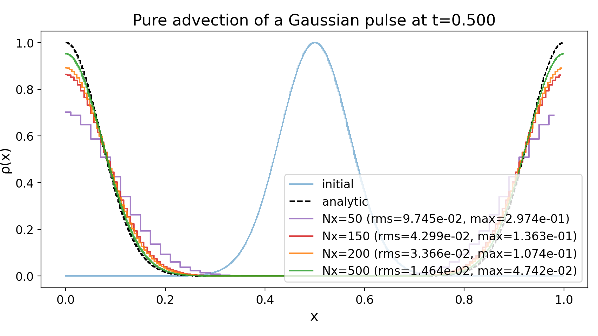
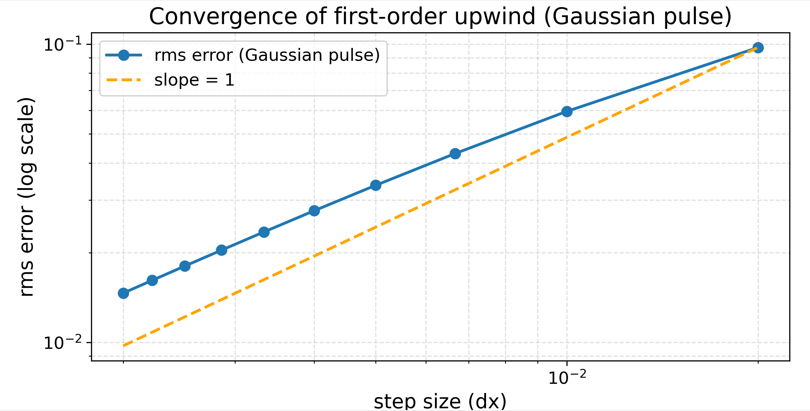
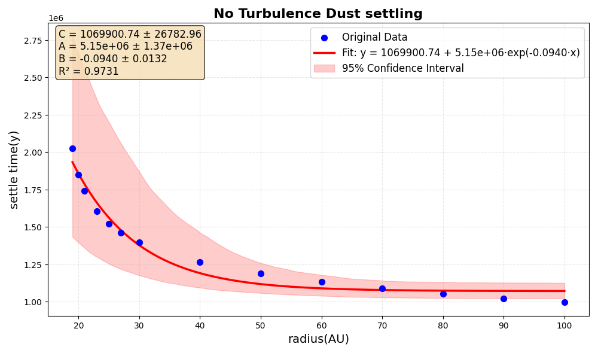
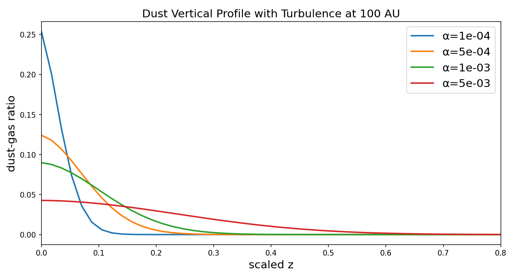
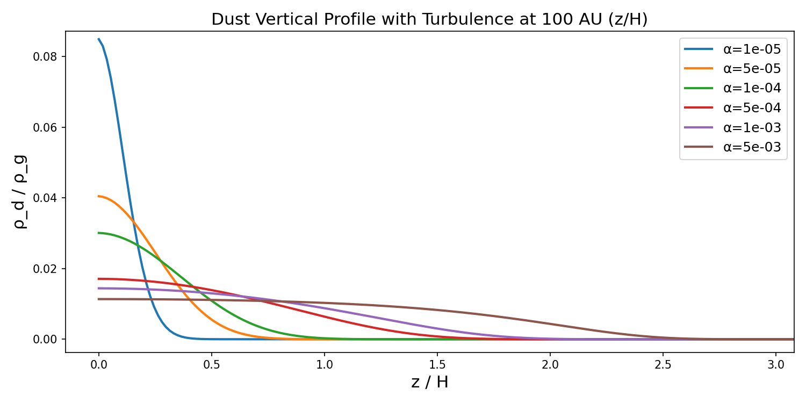
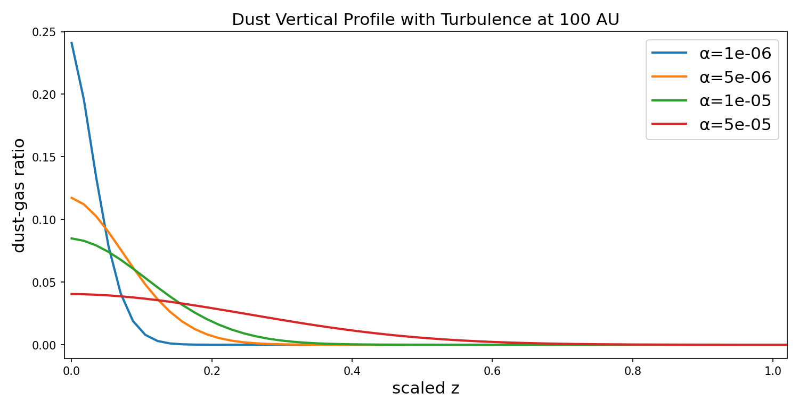

# Dust Settling in Protoplanetary Disks — a 1-D Advection–Diffusion Solver

A from-scratch NumPy finite-difference solver for the vertical **advection–diffusion** evolution
of dust in a protoplanetary disk. The solver integrates over millions of years of physical time
to answer a concrete astrophysical question: **can dust settle towards the midplane fast enough
for the local dust-to-gas ratio to exceed unity** — the threshold for the streaming instability
that produces planetesimals.

Imperial College London, Year-3 Computational Physics (Project 2).
Full write-up: [`docs/report.pdf`](docs/report.pdf).

**Headline result:** in the dense solar-nebula disk prescribed by the project, micron grains
need 1–2 Myr to reach the threshold even with *no* turbulence — and once realistic turbulence
is switched on, **no grain size up to 1 cm reaches it within 1 Myr at all.** Planetesimal
formation therefore requires both grain growth *and* weak turbulence; neither alone suffices.

---

## The physics problem

Dust grains feel vertical stellar gravity and gas drag, which balance into a terminal settling
velocity. Turbulence mixes them back up. The dust density ρ<sub>d</sub>(z, t) obeys

```
∂ρ_d/∂t + ∂/∂z ( u_z ρ_d )  =  D ∂/∂z [ ρ_g ∂/∂z ( ρ_d / ρ_g ) ]
          └─────────────┘        └──────────────────────────────┘
             advection                  turbulent diffusion
```

with

```
u_z(z) = − Ω² z t_s(z) ,     t_s ∝ a / ρ_g(z)      (terminal velocity approximation)
ρ_g(z) = ρ_g0 exp(−z² / 2H²) ,   H = c_s / Ω       (vertical hydrostatic equilibrium)
D      = α c_s² / Ω
```

The diffusion term is deliberately written as **ρ<sub>g</sub> ∂<sub>z</sub>(ρ<sub>d</sub>/ρ<sub>g</sub>)**
rather than the naive ∂<sub>z</sub>ρ<sub>d</sub>. This is the physically correct form: it drives
the system towards a *constant dust-to-gas ratio*, not a constant dust density, so a well-mixed
disk is a genuine steady state of the discretised scheme rather than an artefact.

### Non-dimensionalisation

Solving in natural disk units is what makes Myr-scale integration tractable — it removes the
many-orders-of-magnitude spread in the dimensional coefficients:

| Quantity | Scale | Dimensionless |
|---|---|---|
| length | *H* = c<sub>s</sub>/Ω | z̃ = z/H |
| time | 1/Ω | t̃ = Ω t |
| density | ρ<sub>g0</sub> | ρ̃<sub>d</sub> = ρ<sub>d</sub>/ρ<sub>g0</sub> |
| velocity | *H*Ω | ũ<sub>z</sub> = u<sub>z</sub>/(HΩ) |

giving

```
∂ρ̃_d/∂t̃ = − ∂/∂z̃ ( ũ_z ρ̃_d ) + α ∂/∂z̃ [ ρ̃_g ∂/∂z̃ ( ρ̃_d / ρ̃_g ) ]
```

Disk structure uses the dense solar-nebula prescription from the project brief (*R* in AU):

```
ρ_g0 ≈ 5×10⁻⁷ R⁻³  kg m⁻³        T ∝ R^(−1/2)
c_s  ∝ R^(−1/4)                   Ω ∝ R^(−3/2)
```

Dust starts vertically uniform at ρ<sub>d</sub>/ρ<sub>g</sub> = 0.01 with grain material density
10³ kg m⁻³; default grain size *a* = 1 μm.

> Note this is a **dense** disk — roughly 10²–10³× the canonical MMSN value
> ρ<sub>g0</sub> ≈ 1.4×10⁻⁹ R<sup>−11/4</sup> kg m⁻³. The high gas density strengthens drag,
> and that choice drives the main negative result below.

---

## Numerical method

**Explicit finite differences: first-order upwind for advection, second-order centred for diffusion.**

### Upwinding

The settling velocity is *spatially varying and sign-dependent*, so the upwind direction is
selected per interface rather than globally:

```python
F_adv = v[i+1] * rho[i]     if v[i+1] >= 0    # flow to the right → take left cell
        v[i+1] * rho[i+1]   otherwise         # flow to the left  → take right cell
```

Upwinding is monotonic, non-oscillatory at steep gradients, and positivity-preserving. A centred
difference on the advection term produces oscillations and negative densities. The cost is
numerical diffusion, quantified in the convergence test below.

### Diffusive flux

Evaluated at cell interfaces with the gas density averaged across the face, which keeps the
operator symmetric and conservative:

```python
rho_g_face = 0.5 * (rho_g[i+1] + rho_g[i])
slope      = (ratio[i+1] - ratio[i]) / h        # ratio = rho_d / rho_g
F_diff     = -alpha * rho_g_face * slope
```

### Boundary conditions

- **z = 0 (midplane)** — symmetry. u<sub>z</sub>(0) = 0, so the flux through the lower face
  vanishes and no dust is transported across the midplane.
- **z = z<sub>max</sub> (surface)** — no inflow from the vacuum above: ρ<sub>d</sub> = 0 outside
  the domain. Formally an open boundary, but since dust always drifts *towards* the midplane the
  outflow is negligible in practice.

### Adaptive time step

Δt must satisfy both the hyperbolic and the parabolic stability limit:

```
Δt ≤ min( C_adv · h / max|u_z| ,  C_diff · h² / (α max ρ_g) )
```

with safety factors C<sub>adv</sub> = C<sub>diff</sub> = 0.7 (justified by the sweep in Table 2).

**The velocity cap.** Because u<sub>z</sub> ∝ z/ρ<sub>g</sub>, the settling speed grows
explosively towards the disk surface — it even exceeds c<sub>s</sub>, which violates the subsonic
assumption behind the terminal velocity approximation itself. Left alone this drives
Δt down to ~5×10⁻⁶ yr, dominated entirely by cells where the physics is invalid anyway. A soft cap
|u<sub>z</sub>| ≲ 0.9 c<sub>s</sub> removes the pathology. Table 2 confirms the cap is **never
triggered** for 1 μm grains, so the main results are unaffected by it.

The interior update is fully vectorised with NumPy slice operations, with only the two boundary
cells handled separately.

---

## Verification

### Convergence against an analytic solution

Pure advection of a Gaussian pulse on a periodic domain has the exact solution
ρ(x, t) = ρ<sub>0</sub>(x − vt). Comparing at t = 0.5:

| N<sub>x</sub> | RMS error | Max deviation |
|---|---|---|
| 50 | 9.745×10⁻² | 2.974×10⁻¹ |
| 150 | 4.299×10⁻² | 1.363×10⁻¹ |
| 200 | 3.366×10⁻² | 1.074×10⁻¹ |
| 500 | 1.464×10⁻² | 4.742×10⁻² |

*Table 1 — advection convergence.*





The RMS error falls approximately linearly with grid spacing on a log-log plot, with **measured
slope ≈ 1**, confirming first-order accuracy. The points sit slightly *above* the ideal slope-1
line — the signature of the upwind scheme's intrinsic numerical diffusion, visible directly in
the smeared pulse peaks at coarse resolution. The order of accuracy is unchanged.

### Numerical robustness

Three independent knobs were swept to confirm the physical answer does not depend on them:

| Sweep | Value | Final ρ<sub>d</sub>/ρ<sub>g</sub> | t<sub>settle</sub> (Myr) |
|---|---|---|---|
| **N<sub>z</sub>** | 150 | 1.491 | 1.081 |
| | 200 | 1.985 | 1.017 |
| | 250 | 2.477 | 0.994 |
| | 300 | 2.966 | 0.983 |
| **CFL factor** | 0.30 | 1.9849 | 1.016593 |
| | 0.50 | 1.9849 | 1.016804 |
| | 0.70 | 1.9850 | 1.016593 |
| | 0.90 | 1.9851 | 1.016910 |
| **v-cap factor** | 0.30 | 1.9851 | 1.016910 |
| | 0.50 | 1.9851 | 1.016910 |
| | 0.70 | 1.9851 | 1.016910 |

*Table 2 — robustness tests.*

Reading this table:

- **Resolution** — the midplane ratio keeps climbing with N<sub>z</sub> (a sharper peak is
  resolved), but the *physically meaningful* quantity t<sub>settle</sub> converges: only ≈3%
  between N<sub>z</sub> = 200 and 300. Production runs use **N<sub>z</sub> = 250**, giving a
  quoted numerical uncertainty of **~3%**.
- **Time step** — t<sub>settle</sub> varies by **<0.03%** across CFL factors 0.3→0.9. The
  scheme is stable right up to the theoretical limit, so 0.7 is a safe and efficient choice.
- **Velocity cap** — bit-identical results across all three values, i.e. the cap is never
  reached for 1 μm grains and cannot be biasing the settling results.

Together these bound the numerical uncertainty well below the size of the physical effects
discussed next.

---

## Physical results

### 1. No turbulence: settling takes Myr, and barely depends on radius



Scanning 20–100 AU with no diffusion, micron grains need **≈1.8–2.0 Myr at 20 AU falling to
≈0.99 Myr at 100 AU** to reach ρ<sub>d</sub>/ρ<sub>g</sub> > 1. The fit is an exponential with a
constant offset (R² = 0.973), and the decay is so weak that **beyond ~50 AU the radial dependence
is effectively negligible.**

That near-independence is not a coincidence. Moving outwards the gas thins (faster settling) but
the disk also gets colder and less gravitationally bound (slower settling); the two effects
very nearly cancel. The 20→100 AU spread does exceed the 3% numerical uncertainty, so the weak
trend is real rather than a discretisation artefact.

The physical takeaway is already awkward for planet formation: even in the *complete absence* of
turbulence, settling alone consumes a large fraction of a typical disk lifetime. Any amount of
mixing will therefore matter.

### 2. Turbulence broadens the dust layer and stalls settling



Running to 10⁷ yr — an order of magnitude past the laminar settling time, so the profiles are
essentially in steady state — the midplane dust-to-gas ratio at 100 AU is:

| α | midplane ρ<sub>d</sub>/ρ<sub>g</sub> |
|---|---|
| 10⁻⁴ | ≈0.25 |
| 5×10⁻⁴ | ≈0.12 |
| 10⁻³ | ≈0.089 |
| 5×10⁻³ | ≈0.043 |

**Every value is far below the threshold of 1.** Micron grains do not settle to a planetesimal-
forming concentration at any turbulence level — they reach a stable equilibrium with a broad or
narrow dust layer instead. Stronger diffusion simply thickens that layer.



Comparing layer thickness against observation gives a constraint on α. Disks in the Taurus
cluster show a dust layer of z ≈ 0.1R at R ≈ 100 AU; the simulated profiles match that thickness
for **α ≈ 10⁻⁵–5×10⁻⁵** in this dense-disk model — considerably weaker turbulence than the
α ≲ 10⁻³ typically inferred for lighter disks. The weak-turbulence end of the scan is shown
separately:



### 3. Grain growth alone does not rescue it

Fixing α = 2×10⁻⁴ (the observationally motivated value) and scanning grain radius from 10 μm to
10⁶ μm at 30–100 AU: **no size up to 1 cm reaches ρ<sub>d</sub>/ρ<sub>g</sub> > 1 within 1 Myr.**

Larger grains do settle faster, but turbulent diffusion keeps redistributing material away from
the midplane and the drift never wins. The dense gas is the culprit: high ρ<sub>g</sub> means
strong drag, so settling speed grows much more slowly with size than in a lighter disk.

Above ~10⁶ μm (metre scale) the model itself breaks down — the terminal velocity formula returns
non-physical speeds and >20% of velocities hit the cap. Those runs are reported as invalid rather
than as results, since the full equation of motion would be needed instead of assuming
instantaneous drag–gravity balance.

### Conclusion

In this dense disk, vertical settling plus isotropic turbulence **cannot** produce midplane
self-enrichment. Additional concentration mechanisms — pressure bumps, zonal flows, or the
streaming instability (which itself needs a high dust-to-gas ratio to start) — would be required.
In a lighter, MMSN-density disk the picture is expected to differ: once grains reach mm–cm sizes
their settling should outpace diffusion, consistent with standard dust-evolution models.

**Planetesimal formation requires both grain growth and weak turbulence.**

---

## Repository layout

```
src/
  pure_advection.py              validation solvers for the pure advection equation
                                   PureAdvection1D     — square wave, v < 0
                                   PureAdvection1D_v2  — Gaussian pulse, signed v (subclass)
  dust_solver.py                 laminar settling, no diffusion
                                   DustSolver1D        — dimensionless test problem
                                   RealDiskDustSolver  — physical disk units, t_settle tracking
  dust_solver_turbulence.py      settling + turbulent diffusion — vectorised, MAIN SOLVER
  legacy_turbulence_scalar.py    earlier loop-based version, kept for reference

tests/
  test_convergence_advection.py  analytic-solution convergence study      → Fig 1, 2
  test_numerical_stability.py    resolution / CFL / velocity-cap sweeps   → Table 2
  test_settling_vs_radius.py     laminar settling time vs radius          → Fig 3
  test_turbulence_alpha_scan.py  vertical profile vs turbulence strength  → Fig 4-6
  test_grain_size_scan.py        midplane enhancement vs grain size
  _path_setup.py                 makes ../src importable

results/                         figures reproduced from the report
docs/report.pdf                  full write-up with references
```

`dust_solver_turbulence.py` is the solver to use. It replaces the explicit per-cell loop of the
legacy version with NumPy slice operations over the interior cells, keeping only the two boundary
cells as special cases. That rewrite is what makes the Myr-scale runs and the multi-parameter
sweeps practical — the legacy scalar version is retained purely to document the optimisation.

---

## Usage

```bash
pip install -r requirements.txt      # numpy + matplotlib only

cd tests
python test_convergence_advection.py    # verification: convergence order
python test_numerical_stability.py      # verification: robustness sweeps
python test_settling_vs_radius.py       # physics: laminar settling time vs radius
python test_turbulence_alpha_scan.py    # physics: profile vs turbulence strength
python test_grain_size_scan.py          # physics: enhancement vs grain size
```

Direct use of the solver:

```python
from dust_solver_turbulence import DustSolver_Turbulence

solver = DustSolver_Turbulence(
    total_time=1e6,                     # physical time [years]
    z_spatial_points=250,               # grid cells (converged value)
    advective_number_limitation=0.7,    # C_adv
    diffusion_number_limitation=0.7,    # C_diff
    R_AU=100,                           # disk radius [AU]
    a_micron=1.0,                       # grain radius [micron]
    zmax=4.0,                           # domain height [AU]
    D=alpha * cs**2 / omega,            # turbulent diffusivity [m² s⁻¹]
)

rho_final = solver.run_simulation(stop_when_cross=True)
t_settle  = solver.get_t_formation_years()   # None if the threshold is never reached
ratio     = rho_final / solver.rho_initial   # dust-to-gas ratio profile
```

`stop_when_cross=True` aborts as soon as ρ<sub>d</sub>/ρ<sub>g</sub> > 1, which is what makes the
parameter scans affordable. Long turbulent runs (high α, fine grid) are genuinely expensive
because of the Δt ∝ h²/α parabolic limit — expect minutes per configuration.

---

## Limitations and next steps

- **First-order accurate in space.** Numerical diffusion is visible at coarse resolution
  (Fig. 1). A slope-limited second-order scheme (MUSCL / minmod) would sharpen the profiles at
  comparable cost, and is the natural next step.
- **Explicit time stepping.** The parabolic limit Δt ∝ h²/α dominates at high α, making strongly
  turbulent runs expensive. An implicit or IMEX treatment of the diffusion term would remove that
  restriction entirely.
- **Fixed grain size per run.** No coagulation or fragmentation; real disks evolve a full size
  distribution, and grain growth coupled to settling is exactly the missing physics that the
  size scan can only approximate.
- **Terminal velocity approximation.** Assumes instantaneous drag–gravity balance and breaks down
  for metre-scale grains and in the tenuous surface layers — the reason the velocity cap exists.
- **Vertically isothermal, static gas.** The gas profile is prescribed and does not respond to the
  dust, excluding the streaming instability and drag back-reaction.
- **1-D.** Radial drift is not modelled; each radius is an independent column.

## C++17 port and review checkpoint
The C++17 faithful-port baseline, validation evidence, and Chinese usage notes are in [cpp/README.md](cpp/README.md).
Read [cpp/RUN_LOG.md](cpp/RUN_LOG.md) for independent-review findings, inherited numerical limitations, and the iteration history.